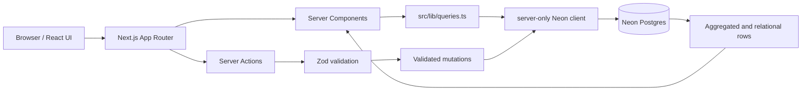
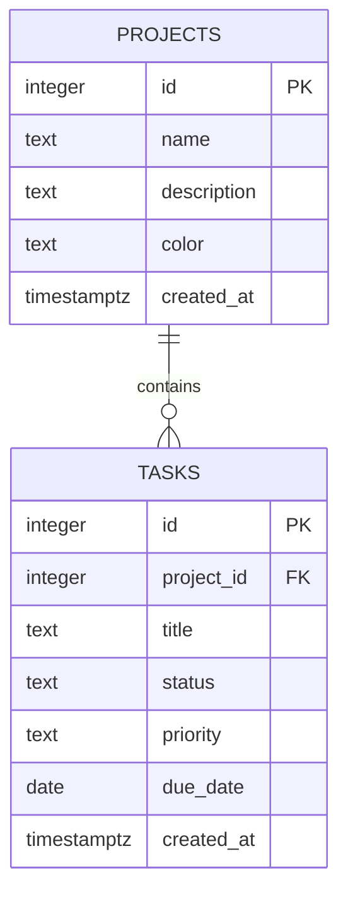

# 16 Project Tracker

**16 Project Tracker** is a full-stack project and task management dashboard built with Next.js and Neon Postgres. It gives users a clear overview of active projects, supports a three-column Kanban workflow, filters tasks by title or priority, and turns database aggregates into workspace statistics such as completion and overdue-task totals.

- **Repository:** [Yakubu-Yusuf13/16-project-tracker](https://github.com/Yakubu-Yusuf13/16-project-tracker)
- **Live demo:** [Deployment pending] *(add the Vercel/hosting URL here once deployed)*

## Problem → solution

Project progress becomes difficult to understand when tasks are scattered across tools or maintained only in a person's memory. 16 Project Tracker solves that problem with one workspace for creating projects, organizing tasks into To Do / Doing / Done states, tracking priorities and due dates, and reviewing completion across the whole workspace.

## Features

- Project creation and deletion with custom project colors and descriptions.
- Live completion progress calculated from completed versus total tasks.
- Three-column Kanban board for To Do, Doing, and Done.
- Task creation, deletion, priority assignment, due dates, and status movement.
- Optimistic task movement and deletion feedback in the Kanban board.
- URL-backed task search and priority filters.
- Workspace statistics for status, priority, project completion, and overdue tasks.
- Server-side Zod validation with field-level form errors.

### Screenshots

> Replace these placeholders with exported images in `public/screenshots/`.

**Dashboard**


**Kanban board**


**Statistics**


## Tech stack and why

| Technology | Why it was chosen |
| --- | --- |
| [Next.js App Router](https://nextjs.org/docs/app) | Provides server and client rendering, Server Components, Server Actions, routing, and metadata in one React framework. |
| [React 19](https://react.dev/) | Makes interactive forms and the Kanban board manageable with hooks such as `useActionState`, `useOptimistic`, and transitions. |
| [TypeScript](https://www.typescriptlang.org/) | Adds compile-time types across database records, actions, filters, and UI components. |
| [Tailwind CSS](https://tailwindcss.com/) | Supports a consistent, responsive interface directly in JSX without maintaining a large custom CSS surface. |
| [Neon Postgres](https://neon.com/) | Provides a serverless Postgres database with constraints, joins, filters, and aggregates suitable for the project/task domain. |
| [`@neondatabase/serverless`](https://github.com/neondatabase/serverless) | Lets the Next.js server run parameterized SQL queries against Neon with minimal database setup. |
| [Zod](https://zod.dev/) | Validates untrusted `FormData` at the server-action boundary and converts it into user-readable field errors. |
| [Vercel](https://vercel.com/) | Fits Next.js deployment and provides environment-variable management for the database connection string. |

## Architecture



App Router Server Components load dashboard, project, and statistics data. `src/lib/queries.ts` contains reads and SQL aggregates, while `src/app/actions.ts` contains create, update, and delete operations. Zod validates action input before parameterized SQL runs, and Next.js revalidation refreshes affected routes. Client components use optimistic updates for responsive Kanban interactions.

## Data model



Project IDs are serial primary keys. Tasks belong to projects through `project_id` and are deleted automatically when their project is deleted. Database check constraints enforce name/title lengths and valid status and priority values.

## Security considerations implemented

- Database credentials are read only from `DATABASE_URL` at runtime; `.env.local` is ignored and must not be committed.
- The Neon database client is isolated behind `server-only`, preventing it from entering browser bundles.
- SQL interpolation is handled through the Neon serverless query API rather than concatenated user input.
- Zod validation restricts project/task fields, positive IDs, enums, color format, lengths, and ISO dates.
- Mutations update or delete tasks only when both task ID and project ID match.
- Project deletion uses a database cascading foreign key to remove dependent tasks.
- Database constraints provide a second validation layer for status, priority, text lengths, and relationships.

> Authentication and authorization are not currently implemented. The existing design is suitable for a personal or demonstration workspace, but user accounts and row-level access control should be added before treating it as a shared or private production service.

## Challenges

- Keeping optimistic Kanban updates synchronized with server-confirmed mutations required clear pending, error, and refresh behavior.
- Combining project totals and task aggregates in useful SQL views required careful use of joins, `FILTER`, grouping, and null handling.
- URL-backed filters had to normalize invalid or repeated search parameters and remain easy to clear.
- Making server validation and database constraints agree took separate Zod schemas and matching SQL checks.

## What I learned

This project strengthened my understanding of Next.js Server Components and Server Actions, React optimistic UI patterns, SQL joins and aggregates, Neon serverless database integration, and the distinction between browser UX validation and server/database enforcement.

## Future improvements

- Add authentication and per-user workspaces with row-level security.
- Add drag-and-drop task movement instead of move-left/move-right controls.
- Persist and restore filters, sorting, and view preferences.
- Add edit flows for projects and tasks.
- Add tests for server actions, SQL queries, validation, and key browser flows.
- Deploy a production database and add monitoring, backups, and migration tooling.
- Replace screenshot placeholders with real dashboard captures.

## Setup

1. Install Node.js (20.9 or later) and npm.
2. Create a Neon project and database. Copy its pooled Postgres connection string from the Neon dashboard.
3. Install dependencies:

   ```bash
   npm install
   ```

4. Create your local environment file and add the connection string:

   ```powershell
   Copy-Item .env.example .env.local
   ```

   Edit `.env.local` and set `DATABASE_URL` to the Neon connection string, including its SSL options. Do not commit `.env.local`.

5. In the Neon SQL Editor, run [`db/schema.sql`](./db/schema.sql) once against the new database. It creates the `projects` and `tasks` tables and includes sample records.
6. Start the development server:

   ```bash
   npm run dev
   ```

7. Open [http://localhost:3000](http://localhost:3000).

## Database schema

- `projects`: serial ID, required 2-80 character name, description, hex color, and creation timestamp.
- `tasks`: serial ID, project foreign key with cascading delete, required 2-140 character title, status (`todo`, `doing`, or `done`), priority (`low`, `medium`, or `high`), optional due date, and creation timestamp.

The schema also defines an index on `tasks.project_id` and check constraints for names, titles, status, and priority.

## Validation

```bash
npm run lint
npm run build
```