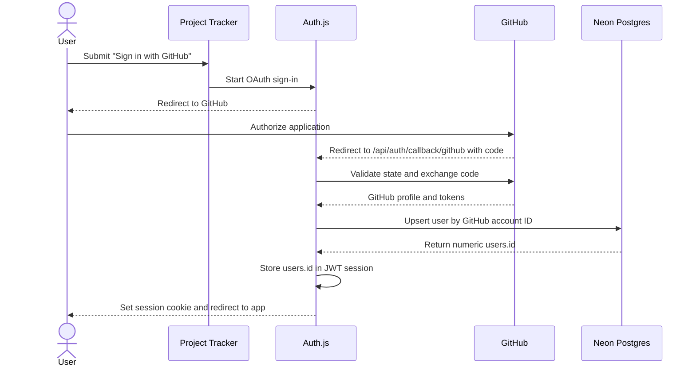

# Project Tracker

A Next.js app for tracking projects and tasks with a Kanban board and workspace statistics.

## Features

- Project dashboard with task totals and project completion progress.
- Project creation and deletion, plus task creation, status changes, and deletion.
- Three-column Kanban board with optimistic task moves and confirmed deletes.
- Task comments in an accessible detail drawer, scoped to the signed-in project owner.
- Priority and title search filters, applied in SQL and reflected in the URL.
- Statistics for task status, priority, overdue tasks, and per-project completion.
- Zod validation for server-action form input.
- GitHub OAuth sign-in using Auth.js v5 JWT sessions.

## Stack

- Next.js App Router, React, and TypeScript
- Tailwind CSS
- Neon Postgres using `@neondatabase/serverless`
- Zod for validation

## Architecture

- App Router Server Components load dashboard, project, and statistics data at request time so database changes are not frozen into a build.
- `src/lib/queries.ts` contains parameterized SQL reads scoped to the authenticated user's projects; task and comment reads join through owned projects. `src/lib/db.ts` creates the server-only Neon client.
- `src/auth.ts` configures Auth.js with GitHub, upserts users by GitHub account ID, and adds the database user ID to JWT and session data.
- `src/proxy.ts` protects application routes and sends unauthenticated requests to `/login` with a relative `callbackUrl`.
- `src/lib/session.ts` provides `requireUser()` guards for data pages and Server Actions.
- The root navigation reads the session in a Suspense boundary; sign-in and sign-out are Server Actions.
- `src/app/actions.ts` contains Server Actions for writes. They validate `FormData` with Zod, require the authenticated user, scope each write by project ownership, check affected rows, and revalidate affected routes.
- `/settings` displays the signed-in GitHub profile and provides a confirmed account deletion action; deleting the user cascades to owned projects and their tasks.
- Client form and Kanban components use `useActionState` and `useOptimistic` for submission feedback and responsive task moves.
- `next.config.ts` applies security headers to all routes.

## Setup

1. Install Node.js (20.9 or later) and npm.
2. Create a Neon project and database. Copy its pooled Postgres connection string from the Neon dashboard.
3. Install dependencies:

   ```bash
   npm install
   ```

4. Create your local environment file:

   ```powershell
   Copy-Item .env.example .env.local
   ```

   Set the variables listed below in `.env.local`. Do not commit `.env.local`.

5. In the Neon SQL Editor, run [`db/schema.sql`](./db/schema.sql) once against the new database. It creates the `users`, `projects`, `tasks`, and `task_comments` tables, adds project ownership, and includes sample project and task records.
   For an existing database that already has the authentication schema, run [`db/migrations/002_task_comments.sql`](./db/migrations/002_task_comments.sql) once instead.
6. Start the development server:

   ```bash
   npm run dev
   ```

7. Open [http://localhost:3000](http://localhost:3000).

## Database schema

- `users`: serial ID, unique GitHub ID, optional name, email, and image, plus a creation timestamp.
- `projects`: serial ID, optional owner reference to `users` with cascading deletion, required 2-80 character name, description, hex color, and creation timestamp.
- `tasks`: serial ID, project foreign key with cascading delete, required 2-140 character title, status (`todo`, `doing`, or `done`), priority (`low`, `medium`, or `high`), optional due date, and creation timestamp.
- `task_comments`: serial ID, cascading task and author references, a required 1-2000 character body, and a creation timestamp.

The schema also defines indexes on project owners, tasks, and task comment chronology, and check constraints for project names, task titles, comment bodies, status, and priority.

## Authentication

### Environment variables

| Variable | Required | Description |
|---|---|---|
| `DATABASE_URL` | yes | Neon Postgres connection string, including its SSL options. |
| `AUTH_SECRET` | yes | Cryptographically random secret used by Auth.js to protect session data. |
| `AUTH_GITHUB_ID` | yes | Client ID for the GitHub OAuth App. |
| `AUTH_GITHUB_SECRET` | yes | Client secret for the GitHub OAuth App. Keep it private; do not commit it. |

### Create a GitHub OAuth App

1. On GitHub, open **Settings → Developer settings → OAuth Apps → New OAuth App**.
2. Set the application name (for example, `Project Tracker (dev)`) and Homepage URL to `http://localhost:3000`.
3. Set Authorization callback URL to `http://localhost:3000/api/auth/callback/github`, then register the application.
4. Copy the displayed Client ID to `AUTH_GITHUB_ID`, generate a new client secret, and save it as `AUTH_GITHUB_SECRET` in `.env.local`.
5. Set `AUTH_SECRET` to a cryptographically random value and restart the development server after changing environment variables.

Do not share or commit OAuth client secrets. Use the same `localhost` hostname in the browser as in the registered callback URL.

### OAuth flow



The session callback exposes the database ID as `session.user.id`. Protected pages and Server Actions use that ID to scope project and task access.

## Route protection

The Next.js 16 `src/proxy.ts` convention redirects unauthenticated page requests, but it is not an authorization boundary for application code: Server Actions can be invoked directly, outside the UI navigation flow. Pages that read private data and data-mutating Server Actions therefore call `requireUser()` themselves. The GitHub sign-in action is intentionally public so unauthenticated users can start login; the sign-out action verifies the session.

The login action validates `callbackUrl` on the server and accepts only same-origin relative paths, falling back to `/` for external or malformed values.

## Project ownership

Projects are visible only to their owner. Task reads and writes are authorized through the owning project, and statistics include only the signed-in user's projects. New projects are assigned to their creator. To claim existing ownerless projects for one user, first sign in once, find that user's `github_id` in `users`, replace `<YOUR_GITHUB_ID>` in [`db/backfill-project-owners.sql`](./db/backfill-project-owners.sql), and run the statement once. It intentionally leaves projects already assigned to an owner unchanged.

## Validation

```bash
npm run lint
npm run build
```